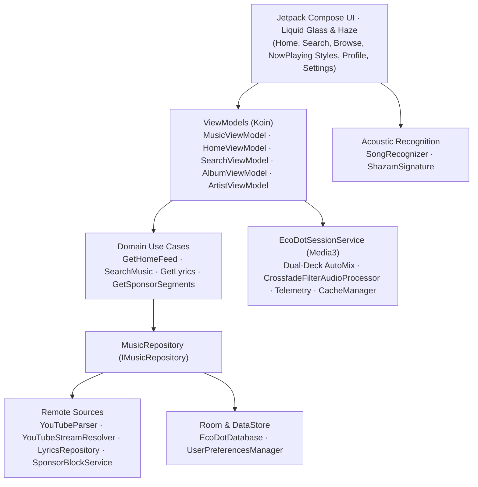

<div align="center">

# 🎵 EcoDot 1.26v

**A vibrant hybrid Android music & video player with realistic Liquid Glass optics, SimpMusic UI architecture, multi-style Now Playing experiences, and ad-free YouTube Music streaming.**

**Made by [Debug01-dEoW aka Deep](https://github.com/Debug01-dEoW)**

[](https://github.com/Debug01-dEoW/EcoDot-MusicApp/releases)
[](https://github.com/Debug01-dEoW)
[](https://kotlinlang.org/)
[](https://developer.android.com/jetpack/compose)
[](LICENSE)

[**Download APK (`EcoDot 1.26v.apk`)**](releases/EcoDot%201.26v.apk) · [**GitHub Releases**](https://github.com/Debug01-dEoW/EcoDot-MusicApp/releases) · [**Developer Profile**](https://github.com/Debug01-dEoW)

</div>

---

## ✨ What's New in EcoDot `1.26v`

EcoDot `1.26v` is a major visual and playback evolution pairing **Apple-inspired Liquid Glass optics** with **SimpMusic's architecture**, **real-time audio engineering telemetry**, and **continuous 1080p music video playback**.

### 🎨 Four Signature Now Playing Styles
Switch seamlessly from the Player Style sheet or your User Profile (`Profile → Player Style`):

| Style | Highlights |
| :--- | :--- |
| **Apple Music** | `6x6` dynamic artwork mesh backdrop + frosted Haze overlay, bare white header/controls, inline synced lyric teaser, double-arrow transport, interactive system volume bar, real-time **`kbps · kHz`** audio telemetry, SimpMusic 3-pill dock, device model label (`Build.MODEL`), and dedicated **Queue** (`Endless queue`) & **Lyrics** tabs |
| **Vinyl Turntable** | 33⅓ RPM spinning tonearm & vinyl platter artwork (`VinylArtworkView`), analog groove lighting, speed-reactive play/pause rotation, and full queue controls |
| **Spotify** | High-contrast obsidian surface cards, bold typography, inline lyrics card preview, and tactile playback bar |
| **EcoDot Classic** | Frosted Liquid Glass centerpiece, waveform/continuous seekbar (`ContinuousSeekBar`), fullscreen & lockscreen synced lyrics, and video/audio toggle |

### 🎬 Seamless Responsive Video Mode (`1080p`)
- **Continuous Queue Transitions**: Skipping Next/Previous or picking tracks from the Queue while in Video Mode preserves active video playback seamlessly without pausing or dropping back to audio-only mode.
- **Responsive Dual Surface**: Hardware-accelerated `TextureView` (`ResponsivePlayerVideoSurface`) and full-screen landscape/portrait gesture player (`FullscreenVideoPlayer`, `VideoPlayerScreen`) with live SRT/LRC subtitle overlay.

### 🔊 Audio Engine, AutoMix & Real-Time Telemetry
- **Live Stream Telemetry**: `YouTubeStreamResolver` and `EcoDotSessionService` expose live negotiated bitrate (`kbps`) and sample rate (`kHz`) directly in the Now Playing HUD (e.g., `140 kbps · 48 kHz`).
- **High Quality Streams**: Supports **`High AAC` (up to `256 kbps` M4A/AAC)** and **High Opus** extraction via NewPipe Extractor (`v0.26.5`).
- **AutoMix & DJ Crossfade**: Equal-power dual-deck Media3 ExoPlayer crossfade engine with custom PCM **`CrossfadeFilterAudioProcessor`** delivering low-pass / high-pass filter sweeps and beat-aware `Auto` fade scaling.
- **SponsorBlock Integration**: Automatic segment skipping for intros, outros, music off-topic sections, and sponsorship reads (`SponsorBlockService`).
- **Built-in Equalizer & Cache**: Parametric EQ presets (`EqualizerScreen`), smart track caching with configurable MB storage limit (`CacheManager`), and offline download management (`CachedSongsScreen`).

### 🧭 SimpMusic Home, Search, Browse & Profile
- **Liquid Glass Home & Refresh**: Authentic top glass chips (`All`, `Moods`, `+`, Settings gear), pull-to-refresh YouTube Music recommendations, region/country chart switching (`RealHomeData`), crisp high-DPI cover art loading (filtering low-res blur artifacts), and deep-scroll **`BrowseScreen`** opened from `"More"` section headers.
- **Categorized Search & Acoustic Recognition**: SimpMusic-style Search (`SearchScreen`, `SearchComponents`) with persistent history, category filters (`Songs`, `Videos`, `Albums`, `Artists`, `Playlists`), and a built-in **Shazam-style audio fingerprint recognizer** (`ShazamSignature`, `SongRecognizer`, `SongRecognitionBottomSheet`).
- **Personalized User Profile**: Persistent local custom avatar picker, chunked genre preference chips, `2x2` gradient listening statistics grid, Top Tracks, Recently Played carousel, and one-tap **Player Style** switcher (`ProfileScreen`).
- **SimpMusic Settings & In-App Updater**: Full categorized Settings (`SettingsScreen`), visual multi-category storage bar, theme accent color picker, and dual-source in-app updater (`AppUpdateManager` + `UpdateDialog`).

---

## 🏗️ Architecture

EcoDot follows **Clean Architecture + MVVM** with **Koin** dependency injection, **Room** persistence, **Media3** background media session management, and **Jetpack Compose + Haze** rendering:



---

## 📁 Project Structure

```text
EcoDot-MusicApp/
├── releases/
│   ├── EcoDot 1.26v.apk                 # Latest EcoDot 1.26v build
│   ├── EcoDot-v1.2-liquid-glass.apk     # Previous v1.2 build
│   └── EcoDot-v1.0-beta.apk             # Initial beta release
├── version.json                         # Remote update manifest read by AppUpdateManager
├── gradle/libs.versions.toml            # Version catalog (AGP 9.2.1, Kotlin 2.2.10, Media3 1.5.1)
└── app/src/main/
    ├── assets/version.json              # Offline fallback update manifest
    ├── res/layout/responsive_player_video_view.xml
    └── java/com/example/ecodot/
        ├── EcoDotApplication.kt & MainActivity.kt
        ├── data/
        │   ├── local/{dao,database,entities,prefs}/
        │   ├── remote/                  # YouTubeParser, StreamResolver, RealHomeData, Lyrics, SponsorBlock
        │   └── repository/MusicRepository.kt
        ├── di/                          # App, Database, Network, Repository, UseCase, ViewModel modules
        ├── domain/{model,repository,usecase}/
        ├── playback/                    # EcoDotSessionService, AudioEffectManager, CrossfadeFilterAudioProcessor, CacheManager
        ├── recognition/                 # ShazamSignature, SongRecognizer
        ├── ui/
        │   ├── components/              # LiquidGlass, GlassTilt, SimpBottomNavigationBar, MiniPlayer, HomeComponents, SearchComponents, UpdateDialog, etc.
        │   ├── components/player/       # AppleMusicStyleContent, VinylStyleContent, SpotifyStyleContent, ResponsivePlayerVideoSurface, PlayerStyleUtils, FullScreenLyricsView, etc.
        │   ├── screens/                 # HomeScreen, SearchScreen, BrowseScreen, NowPlayingScreen, VideoPlayerScreen, ProfileScreen, SettingsScreen, LibraryScreen, etc.
        │   ├── theme/                   # Color, SimpIcons, Theme, Type
        │   └── viewmodel/               # MusicViewModel, HomeViewModel, SearchViewModel, AlbumViewModel, ArtistViewModel
        └── util/                        # AppUpdateManager, AppUpdateModel, NetworkMonitor, PermissionHandler, PlaylistCustomization
```

---

## 📥 Installation & Build

### Install the APK
1. Download [**`EcoDot 1.26v.apk`**](releases/EcoDot%201.26v.apk) (or visit [**Releases**](https://github.com/Debug01-dEoW/EcoDot-MusicApp/releases)).
2. Enable **"Install from unknown sources"** on your Android device (**Android 7.0 / API 24+** required, targets API 37).
3. Open the APK and enjoy!

### Build from Source
```bash
git clone https://github.com/Debug01-dEoW/EcoDot-MusicApp.git
cd EcoDot-MusicApp

# Run unit test suite
./gradlew testDebugUnitTest

# Build EcoDot 1.26v APK
./gradlew assembleDebug
```

---

## 👨‍💻 Author & Credits

<div align="center">

### **Made by Debug01-dEoW aka Deep**

[](https://github.com/Debug01-dEoW)
[](https://github.com/Debug01-dEoW/EcoDot-MusicApp)
[](https://github.com/Debug01-dEoW/EcoDot-MusicApp/releases)

UI/UX inspiration from **SimpMusic**, **Apple Music**, and **Spotify**, built with **Jetpack Compose**, **Media3 ExoPlayer**, **Haze Liquid Glass**, and **NewPipe Extractor**.

</div>

---

## 📄 License

This project is licensed under the **MIT License** — see the [LICENSE](LICENSE) file for details.
