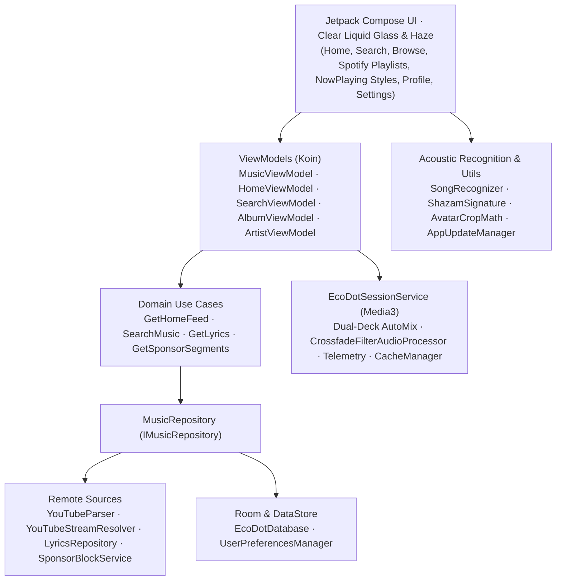

<div align="center">

# 🎵 EcoDot 1.27v

**A fast 120Hz Android music & video player combining crystal-clear Liquid Glass optics, Spotify-inspired playlists, Apple Music / Vinyl / Spotify player styles, seamless 1080p video playback, AutoMix DJ crossfade, and ad-free YouTube Music streaming.**

**Made by [Debug01-dEoW aka Deep](https://github.com/Debug01-dEoW)**

[](https://github.com/Debug01-dEoW/EcoDot-MusicApp/releases)
[](https://github.com/Debug01-dEoW)
[](https://kotlinlang.org/)
[](https://developer.android.com/jetpack/compose)
[](LICENSE)

[**Download APK (`EcoDot 1.27v.apk`)**](releases/EcoDot%201.27v.apk) · [**GitHub Releases**](https://github.com/Debug01-dEoW/EcoDot-MusicApp/releases) · [**Developer Profile**](https://github.com/Debug01-dEoW)

</div>

---

## 📣 What's New & Release News (`1.27v`)

EcoDot `1.27v` delivers a major polish pass focused on **120Hz butter-smooth performance**, **crystal-clear Liquid Glass lens refraction**, **authentic Spotify-style playlists**, **a complete scrollable 3-dots Track Options menu**, **interactive circular profile picture adjustment**, and **over-the-air update notifications for all `v1.26v` users**.

### 🎧 Spotify-Style Playlists & Full Track Actions
- **Authentic Playlist Detail Screen (`PlaylistDetailScreen`)**: Centered rounded artwork (featuring Spotify's purple gradient Heart cover on *Liked Songs* and dynamic `2x2` album mosaics on playlists), smooth `Palette` ambient hero gradients, one-tap Download All, track reordering, Shuffle, and a green circular Play/Pause FAB.
- **Complete Scrollable Track Options Sheet (`TrackOptionsBottomSheet`)**: Grouped matte cards with Quick Actions (`Play Next`, `Add Queue`, `Playlist`) plus every action cleanly accessible across Home, Search, Library, and Playlists — `Play Now`, `Save/Remove Liked Songs`, `Download`, `Remove from Playlist`, `Switch to Music Video/Audio`, `Sleep Timer`, `Looping Canvas`, `Now Playing Style`, `Equalizer`, `Set as Ringtone`, `Go to Album`, and `Go to Artist`.

### ✨ Crystal-Clear Liquid Glass & 120Hz Smoothness
- **Clear Optical Lens Glass**: Restored crisp low-haze lens refraction across Home header pills (`Profile`, `All`, `Mood`, `+ | Settings`), Search Bar, `SimpChip` filters, `MiniPlayer`, and `SimpBottomNavigationBar`, while removing dark sticky box artifacts behind Home chips and `"Recent searches | Clear search history"`.
- **120Hz Display Engine & R8 Minification**: Selects hardware 120Hz display mode (`preferredDisplayModeId`), isolates per-frame playback progress state reads across seekbars/lyrics, uses single-pass sibling backdrop captures, and ships R8-minified release APKs (`~8.3 MB`).

### 👤 Minimal Profile & Interactive Photo Cropper
- **Circular Avatar Cropper (`ProfileScreen` + `AvatarCropMath`)**: Upload any gallery photo and adjust it inside a circular crop overlay with pinch/drag pan, zoom slider (`1x–5x`), and 90° rotation before saving cleanly.
- **Clutter-Free Profile & Themes**: Removed extra analytics clutter from Profile and removed the redundant `Song / Video` toggle bar from **Spotify** and **Vinyl** player themes (Video switching remains one tap away inside the 3-dots menu).

### 🎨 Four Signature Now Playing Styles
Switch seamlessly from the Player Style sheet (`Track Options → Now Playing Style` or Player Header):

| Style | Highlights |
| :--- | :--- |
| **Apple Music** | `6x6` dynamic artwork mesh backdrop + frosted Haze overlay, bare white header/controls, inline synced lyric teaser, double-arrow transport, interactive system volume bar, real-time **`kbps · kHz`** audio telemetry, 3-pill dock, device model badge (`Build.MODEL`), and dedicated **Queue** & **Lyrics** tabs |
| **Vinyl Turntable** | 33⅓ RPM spinning tonearm & vinyl platter artwork (`VinylArtworkView`), analog groove lighting, speed-reactive rotation, and full queue controls |
| **Spotify** | High-contrast obsidian surface cards, bold typography, inline lyrics card preview, and tactile playback bar |
| **EcoDot Classic** | Frosted Liquid Glass centerpiece, continuous seekbar (`ContinuousSeekBar`), fullscreen & lockscreen synced lyrics, and ambient video support |

### 🔊 Audio Engine, AutoMix & Over-the-Air Updater
- **Live Stream Telemetry**: Real-time bitrate (`kbps`) and sample rate (`kHz`) read directly from active stream & Media3 session state.
- **AutoMix & DJ Crossfade**: Equal-power dual-deck ExoPlayer crossfade engine with **`CrossfadeFilterAudioProcessor`** delivering low-pass / high-pass filter sweeps and beat-aware `Auto` scaling, plus **High AAC (`256 kbps`)** and **SponsorBlock** skipping.
- **Upgraded In-App Update Screen (`UpdateDialog` & `AppUpdateManager`)**: Displays Release News & Highlights, `v1.26v -> v1.27v` version delta badges, APK size chips, categorized change cards, and one-tap APK download & installation so `v1.26v` users are automatically notified when `1.27v` ships.
- **Home Page Credit Footer**: Features clickable attribution (**`Made by Debug01-dEoW aka Deep`**) linking directly to GitHub alongside `© 2026 EcoDot v1.27v`.

---

## 🏗️ Architecture

EcoDot follows **Clean Architecture + MVVM** with **Koin** dependency injection, **Room** persistence, **Media3** background media session management, and **Jetpack Compose + Liquid Glass + Haze** rendering:



---

## 📁 Project Structure

```text
EcoDot-MusicApp/
├── releases/
│   ├── EcoDot 1.27v.apk                 # Latest R8-optimized 120Hz release APK
│   ├── EcoDot 1.26v.apk                 # Previous v1.26 release build
│   ├── EcoDot-v1.2-liquid-glass.apk     # Previous v1.2 build
│   └── EcoDot-v1.0-beta.apk             # Initial beta release
├── version.json                         # Remote OTA update manifest (polled by AppUpdateManager)
├── gradle/libs.versions.toml            # Version catalog (AGP 9.2.1, Kotlin 2.2.10, Media3 1.5.1)
└── app/src/main/
    ├── assets/version.json              # Offline fallback update manifest
    ├── res/layout/responsive_player_video_view.xml
    └── java/com/example/ecodot/
        ├── EcoDotApplication.kt & MainActivity.kt
        ├── data/
        │   ├── local/{dao,database,entities,prefs}/
        │   ├── remote/                  # YouTubeParser, StreamResolver, RealHomeData, Lyrics, SponsorBlock
        │   └── repository/MusicRepository.kt
        ├── di/                          # App, Database, Network, Repository, UseCase, ViewModel modules
        ├── domain/{model,repository,usecase}/
        ├── playback/                    # EcoDotSessionService, AudioEffectManager, CrossfadeFilterAudioProcessor, CacheManager
        ├── recognition/                 # ShazamSignature, SongRecognizer
        ├── ui/
        │   ├── components/              # LiquidGlass, SimpBottomNavigationBar, MiniPlayer, TrackOptionsMenu, UpdateDialog, etc.
        │   ├── components/player/       # AppleMusicStyleContent, VinylStyleContent, SpotifyStyleContent, ResponsivePlayerVideoSurface, etc.
        │   ├── screens/                 # HomeScreen, SearchScreen, BrowseScreen, PlaylistDetailScreen, NowPlayingScreen, ProfileScreen, SettingsScreen, etc.
        │   ├── theme/                   # Color, SimpIcons, Theme, Type
        │   └── viewmodel/               # MusicViewModel, HomeViewModel, SearchViewModel, AlbumViewModel, ArtistViewModel
        └── util/                        # AppUpdateManager, AppUpdateModel, AvatarCropMath, NetworkMonitor, PermissionHandler, PlaylistCustomization
```

---

## 📥 Installation & Build

### Install the APK
1. Download [**`EcoDot 1.27v.apk`**](releases/EcoDot%201.27v.apk) (or update in-app from `EcoDot 1.26v` via [**Releases**](https://github.com/Debug01-dEoW/EcoDot-MusicApp/releases)).
2. Enable **"Install from unknown sources"** on your Android device (**Android 7.0 / API 24+** required, targets API 37).
3. Open the APK and enjoy!

### Build from Source
```bash
git clone https://github.com/Debug01-dEoW/EcoDot-MusicApp.git
cd EcoDot-MusicApp

# Run unit test suite
./gradlew testDebugUnitTest

# Build R8-optimized 120Hz EcoDot 1.27v release APK (or assembleDebug for development)
./gradlew assembleRelease
```

---

## 👨‍💻 Author & Credits

<div align="center">

### **Made by Debug01-dEoW aka Deep**

[](https://github.com/Debug01-dEoW)
[](https://github.com/Debug01-dEoW/EcoDot-MusicApp)
[](https://github.com/Debug01-dEoW/EcoDot-MusicApp/releases)

UI/UX inspiration from **SimpMusic**, **Apple Music**, and **Spotify**, built with **Jetpack Compose**, **Media3 ExoPlayer**, **Haze Liquid Glass**, and **NewPipe Extractor**.

</div>

---

## 📄 License

This project is licensed under the **MIT License** — see the [LICENSE](LICENSE) file for details.
