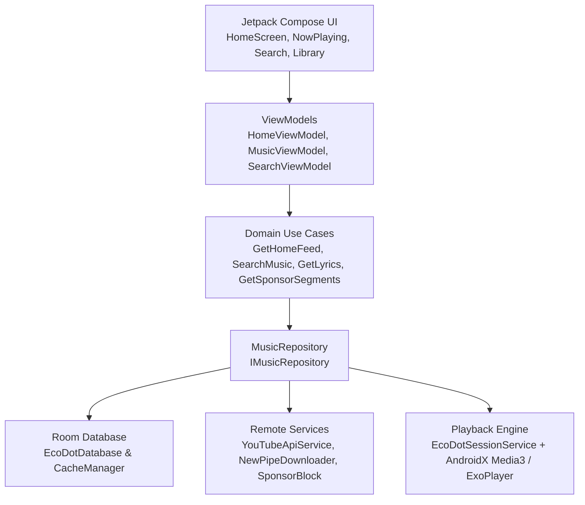

<div align="center">

# 🎵 EcoDot
### The Vibrant Hybrid Android Music Player with Liquid Glass Optics

[](https://developer.android.com)
[](https://kotlinlang.org)
[](https://developer.android.com/jetpack/compose)
[](https://developer.android.com/guide/topics/graphics/agsl)
[](https://developer.android.com/media/media3)
[](LICENSE)
[](releases/EcoDot-v1.2-liquid-glass.apk)

<br/>

**[📥 Download Latest APK (v1.2 Liquid Glass)](releases/EcoDot-v1.2-liquid-glass.apk)**

<br/>

> **EcoDot** is a modern, high-performance hybrid music player bridging your **local audio library** and the entire **YouTube Music catalog** — wrapped in an ultra-realistic, physics-driven **Liquid Glass** design system inspired by Apple VisionOS and SimpMusic.

</div>

---

## 🌟 Highlights & What's New in v1.2

### 💧 Realistic Liquid Glass Optics (AGSL RuntimeShader)
- **Optical Lens Refraction**: Curved edge refraction shaders distorting background elements with authentic glass depth.
- **Chromatic Aberration & Dispersion**: Real-time prismatic color splitting along refractive boundaries.
- **Vibrancy & Saturation Boost**: Prevents washed-out hazy fog; background colors shine through crystal-clear.

### 🧭 Gyroscope-Reactive Specular Rim
- Reads device orientation vectors via `Sensor.TYPE_ROTATION_VECTOR` (with accelerometer fallback).
- Silky smooth low-pass filtering (`0.15f`) ensures 60–120fps motion with zero jitter.
- The directional highlight angle and specular border gradient physically shift across the MiniPlayer and navigation bar rims as you tilt the phone in your hand.

### 🧭 SimpMusic Unified Collapsible Navigation & MiniPlayer
- **Unified Single-Row Architecture (Media Active)**: When music is playing, the navigation bar collapses into a compact 54dp circular glass tab button on the left with the MiniPlayer taking the remaining width. Eliminates bulky vertical stacks and keeps your screen open for content browsing.
- **Expanded Liquid Glass Capsule (Idle / Expanded)**: Features an elongated capsule holding Home and Library with an organic sliding frosted glass blob indicator, paired with a standalone 56dp circular glass Search FAB.
- **Fluid Morphing Transitions**: Transitioning between states animates with spring-damped physics and liquid squash & stretch volume preservation.
- **Authentic SimpMusic Explicit Vector Badge**: Embedded vector SimpIcons.Explicit icon for pristine high-DPI rendering, matching SimpMusic pixel-for-pixel.
- **Fixed Marquee & Typography**: Added 2000ms delay and 40dp spacing to prevent duplicate text looping artifacts on short titles.

### 🖼️ 3D Card Depth Parallax on Scroll
- Carousel cards calculate their position relative to the viewport center during horizontal scrolling.
- Cards angle inward (`rotationY = delta * -5.5f`, `cameraDistance = 14f * density`).
- Album artwork inside the card shifts in reverse (`translationX = delta * 7.dp`) with an 8% bleed margin, giving tangible stereoscopic depth.

### 🎙️ Fullscreen Lyrics with Dynamic Waveform Seekbar
- Real-time vertical audio wave bars with glow cursor.
- Interactive audio scrubbing directly on the waveform.
- Synchronized time-stamped lyrics auto-scrolling with the music.

### 🎵 100% Real Music & Artist Catalog
- Completely eliminated placeholder stock photos.
- **Quick Picks 4-Row Grid**: Instant access to real verified hits (*Die With A Smile*, *Starboy*, *The Hills*, *Chaleya*, *Sunflower*, *Tum Hi Ho*, etc.).
- **Dynamic YouTube Shelves**: Real Hindi Hits, Global Charts, Top 100 Live Performances, and trending music videos.
- **Mood Capsules**: Instant ambient background changes (Twilight Dusk, Electric Crimson, Golden Bokeh) with curated songs for *Relax*, *Workout*, *Focus*, and *Chill*.

---

## 📱 Features Overview

| Feature | Description |
|---|---|
| **YouTube Music Engine** | Stream any track, album, or playlist from YouTube Music without account login. |
| **NewPipeExtractor Resolver** | High-bitrate audio streaming with client cipher decryption (bypasses n-sig throttling). |
| **SponsorBlock Integration** | Automatically skips intros, outros, and non-music video sponsor segments. |
| **Smart Offline Cache** | Cache played tracks automatically or download manually for offline listening. |
| **Local Music Player** | Scans device storage, reads ID3 tags, and organizes albums, artists, and playlists. |
| **Now Playing & MiniPlayer** | Seamless expandable player, gesture-based pull-to-dismiss, and compact liquid glass pill. |
| **5-Band Equalizer** | Bass Boost, Virtualizer effect sliders, and customized audio presets. |
| **Ringtone Clipper** | Built-in waveform audio cutter for creating custom ringtones. |

---

## 🛠️ Architecture & Tech Stack



- **UI & Design**: Jetpack Compose, Material Design 3, Compose Navigation, Kyant Backdrop (AGSL Shaders), Chris Banes Haze.
- **Language**: Kotlin 2.x (100% Coroutines, StateFlow, SharedFlow).
- **Audio Engine**: AndroidX Media3 ExoPlayer, MediaSessionService, AudioEffectManager.
- **Data & Storage**: Android Room Database, DataStore Preferences, OkHttp3, Retrofit.
- **Image Pipeline**: Coil 2.x with crossfade transitions and memory caching.

---

## 📂 Project Structure

```text
EcoDot-MusicApp/
├── app/
│   ├── src/main/java/com/example/ecodot/
│   │   ├── data/
│   │   │   ├── local/          # Room entities, DAOs, Database
│   │   │   ├── remote/         # InnerTube API, NewPipeDownloader, SponsorBlock
│   │   │   └── repository/     # MusicRepository implementation
│   │   ├── di/                 # Dependency injection modules
│   │   ├── domain/             # Models and business logic use cases
│   │   ├── playback/           # Media3 playback service & audio effects
│   │   ├── ui/
│   │   │   ├── components/     # LiquidGlass, SimpBottomNavigationBar, MiniPlayer, GlassTilt
│   │   │   ├── screens/        # HomeScreen, NowPlayingScreen, SearchScreen, LibraryScreen
│   │   │   ├── theme/          # Typography, Color, SimpIcons
│   │   │   └── viewmodel/      # HomeViewModel, MusicViewModel, SearchViewModel
│   │   └── MainActivity.kt     # App entry point & global composition providers
│   └── src/main/java/com/kyant/ # Kyant Backdrop AGSL Shader Runtime
└── releases/                   # Published standalone APK releases
```

---

## 🚀 Building & Running

### Prerequisites
- **Android Studio Meerkat** (2024.3+) or newer
- **JDK 17** or **JDK 21**
- Physical Android device running **Android 8.0+ (API 26+)** recommended for AGSL RuntimeShader support

### Clone & Build
```bash
# Clone the repository
git clone https://github.com/Debug01-dEoW/EcoDot-MusicApp.git

# Navigate to project folder
cd EcoDot-MusicApp

# Build debug APK
./gradlew assembleDebug

# Install on connected device via ADB
./gradlew installDebug
```

---

## 📄 License

Distributed under the **MIT License**. See `LICENSE` for more information.

<div align="center">

Crafted with ❤️ using **Jetpack Compose** & **Kotlin**

**EcoDot** — *Music Without Boundaries*

</div>
